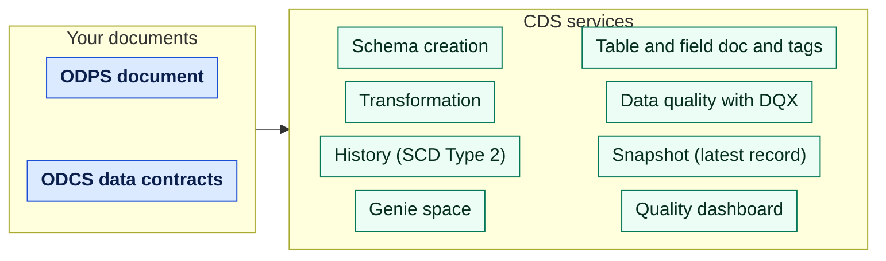

# CDS (Contract Driven Services)

CDS is a data engineering framework that builds data products on Databricks from data
contracts written with the
[Open Data Contract Standard (ODCS)](https://bitol-io.github.io/open-data-contract-standard/latest/).

You describe the tables of your data products in ODCS contracts and small Python
configuration files, and the data products themselves, optionally, in
[Open Data Product Standard (ODPS)](https://bitol-io.github.io/open-data-product-standard/latest/)
documents. The services of the framework then create and document the
tables, load them, check their quality with [DQX](https://databrickslabs.github.io/dqx/)
and keep their history. Conventions apply by default, and can be overridden for a
group of data products, a data product or a single contract.

## Services



The contracts drive every service. The data product document, when there is one, adds
the description of the data product and the fields its contracts share (domain, status,
support...), the title and instructions of its Genie space, and the title of its
quality dashboard.

## Repository

| Folder | Content |
| --- | --- |
| [cds-framework](cds-framework/README.md) | The framework, a Python library (`cds`), and its service notebooks. |
| [cds-demo](cds-demo/README.md) | A demo data product built from the enterprise register of Québec. |
| [cds-demo/deploy](cds-demo/deploy/README.md) | The deployment of the demo with Pulumi and GitHub Actions. |

## Getting started

The repository is a [uv](https://docs.astral.sh/uv/) workspace:

```bash
uv sync --all-packages             # creates .venv with the framework and the demo
uv run pytest                      # unit tests, without Spark
uv run mypy                        # type checks, strict
uv run cds validate cds-demo/products
```

## Continuous integration

- [ci.yml](.github/workflows/ci.yml) lints, type-checks and tests the repository on each push and pull request.
- [deploy-demo.yml](.github/workflows/deploy-demo.yml) deploys the demo to Databricks.
